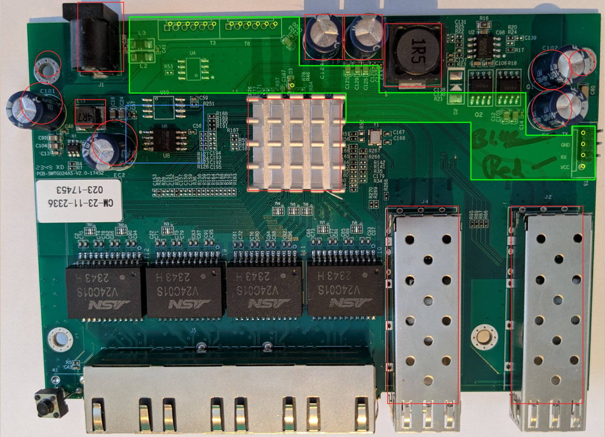

# Mod chip board outline

A single rigid board that mates with T3, T8 and T5 on an SWTG024AS-V2.0 and reaches the reset line at
D3. It avoids every through-hole or tall part and leaves the SPI flash U8 free for a test clip.



| File | What |
|---|---|
| `outline.py` | The outline, the header holes and the obstacles in one place. Running it checks the clearances and writes the files below |
| `modchip-outline.dxf` | Edge.Cuts, the header holes and the reset pad, in mm, origin at T3 pin 1, Y up |
| `modchip-outline.svg` | 1:1 template with the outline, holes, obstacles and the U8 clip zone |
| `overlay.jpg` | The same drawn on the board photo it was measured on (unmanaged) |
| `overlay-managed.jpg` | The same on a second, independent photo: a managed board from [up-n-atom/SWTG118AS](https://github.com/up-n-atom/SWTG118AS/blob/main/photos/SWGT024AS-v2.0/SWTG024AS-v2-pcb-top.jpg) |

Regenerate everything with:

```
python3 outline.py --photo ../../doc/devices/photos/SWTG024AS-v2.0-unmanaged/SWTG024AS-v2.0-top-uman.png
python3 outline.py --photo SWTG024AS-v2-pcb-top.jpg --calibration managed   # downloaded from the link above
```

It exits non-zero if the outline comes closer than 1.2 mm to an obstacle or the U8 clip zone, or if a
header hole sits less than 1.5 mm from the edge.

## Where the numbers come from

Everything is measured on the photo of an unmanaged SWTG024AS-V2.0, calibrated on U8's 1.27 mm pin
pitch (23.5 px/mm).

- **Pitches.** T3 and T8 come out at 2.0 mm pitch, T5 at 2.54 mm.
- **Accuracy.** Expect about ±0.5 mm near the middle of the photo and worse towards its edges, where
  T5 is.
- **Tall parts.** They are placed by their footprint on the PCB, not by their tops, which perspective
  pushes away from the centre of the photo.

## Cross-check on the managed board's photo

The managed photo is close to a flat scan at 38.3 px/mm. It's calibrated on its own, from U8's pin
pitch, T3's hole pitch and the board's rear-left corner, not fitted to the outline. On it:

- **Parts to avoid.** Every one lands inside its marked footprint: J1, C124, C127 (C123 on the
  unmanaged board), the 1R5 inductor, the heatsink, C102/EC1, EC2, L13, the SFP cages and U8's clip zone.
- **Capacitors.** The round capacitors sit centred in their circles, which supports placing tall parts
  by footprint rather than by their tops in the perspective photo.
- **Pitches.** 2.0 mm for T3 and 2.55 mm for T5, the latter measured over three pitches.
- **Holes.** The markers sit about 0.7 mm left of and 0.8 mm in front of the T3/T8 holes, and about
  0.4 mm off the T5 holes. Between T3 pin 1 and T5 pin 1, the two photos differ by 0.4 mm across and
  0.6 mm front to back.

The two photos agree to within about a millimetre: enough for the outline's clearances, not enough to
place connectors that must mate. Calipers decide that.

The managed board differs only in fitted parts: it has the reset button K1, T5 without pins, and a
W25Q16JV (2 MiB) at U8, in the same 208-mil SOIC-8 footprint.

## Before ordering a board

1. **Check the print scale.** Print `modchip-outline.svg` at 100 % (A4 landscape fits) and measure the
   50 mm scale bar.
2. **Lay the print on the switch.** Use the bare PCB, with the ports at the bottom of the page. Confirm
   that:
   - the holes fall on T3, T8 and T5;
   - the green outline clears J1, C124/C123, the 1R5 inductor, the heatsink, C102/EC1 and the SFP cages;
   - the blue zone around U8 is free.
3. **Measure with calipers.** Do this on both switches, the MokerLink and the XikeStor:
   - the T3 pin 1 to T8 pin 6 distance (24.0 mm expected);
   - the T3 pin 1 to T5 pin 1 offset (94.5 mm across, 24.4 mm towards the front, expected);
   - the T5 pitch.
4. **Measure heights.** The lid's inside height over T3/T8 and over the tail, which needs at least
   about 9 mm.
5. **Update and rerun.** Put the measured positions into `outline.py`, run it again, then import the
   DXF into KiCad: File → Import → Graphics, layer Edge.Cuts, units mm.

If the two switches differ, or the tail's fit is too tight to rely on, cut the board at x ≈ 62 mm. That
leaves the main section over T3/T8 and the reset pad, about 39 × 16 mm, and T5 goes back to a 3-wire
harness.
