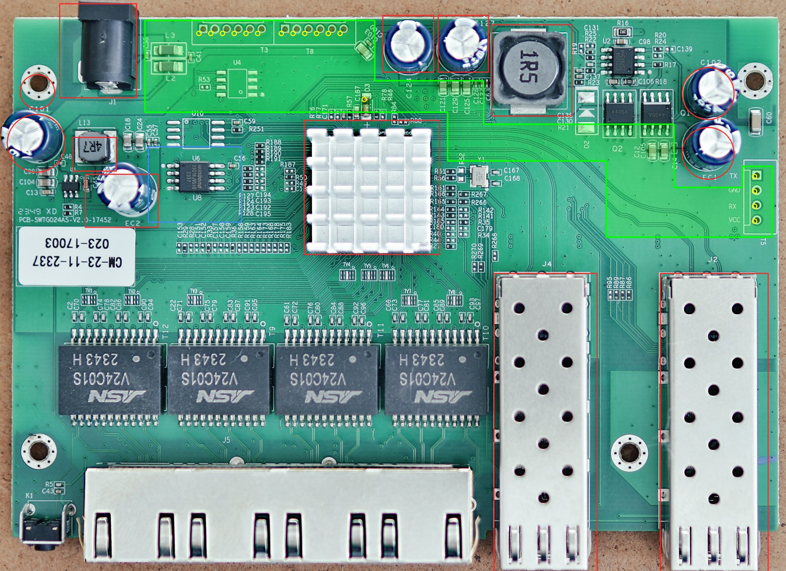

# Mod chip board outline

A single rigid board that mates with T3, T8 and T5 on an SWTG024AS-V2.0 and reaches the reset line at
D3. It avoids every through-hole or tall part and leaves the SPI flash U8 free for a test clip.



| File | What |
|---|---|
| `modchip.kicad_pcb`, `modchip.kicad_pro` | KiCad 10 board: the outline on Edge.Cuts, J1-J3 on the bottom side on the T3, T8 and T5 holes, TP1 above D3 for the reset wire to D3's anode, the switch's parts on Dwgs.User, U8's clip zone on Cmts.User. Aux and grid origin at T3 pin 1 |
| `make_pcb.py`, `finish.py`, `build.sh`, `modchip.kicad_dru` | Layout and routing pipeline (below), with JLCPCB's design rules |
| `modchip.kicad_sch`, `schematic.pdf` | KiCad 10 schematic of the whole mod chip, and a PDF of it |
| `make_sch.py`, `kisexpr.py` | Generate the schematic: every pin's net is listed in `make_sch.py` |
| `check_sch.py`, `expected-nets.json` | ERC, and KiCad's netlist compared pin by pin with the intended nets |
| `outline.py` | The outline, the header holes and the obstacles in one place. Running it checks the clearances and writes the files below |
| `modchip-outline.dxf` | Edge.Cuts, the header holes and the reset pad, in mm, origin at T3 pin 1, Y up |
| `modchip-outline.svg` | 1:1 template with the outline, holes, obstacles and the U8 clip zone |
| `overlay-managed.jpg` | The same drawn on the photo it is measured on: a managed board from [up-n-atom/SWTG118AS](https://github.com/up-n-atom/SWTG118AS/blob/main/photos/SWGT024AS-v2.0/SWTG024AS-v2-pcb-top.jpg) |
| `overlay.jpg` | The same on the unmanaged board's photo in `doc/devices/photos/`, as a cross-check |

Regenerate everything with:

```
python3 outline.py --photo SWTG024AS-v2-pcb-top.jpg --calibration managed   # downloaded from the link above
python3 outline.py --photo ../../doc/devices/photos/SWTG024AS-v2.0-unmanaged/SWTG024AS-v2.0-top-uman.png
```

It exits non-zero if the outline comes closer than 1.2 mm to an obstacle or the U8 clip zone, or if a
header hole sits less than 1.5 mm from the edge.

## Schematic

`modchip.kicad_sch` is generated by `make_sch.py`, which lists the net of every pin of every part;
it refuses to write a schematic with a pin left unassigned. Nets are drawn as global labels on short
stubs at the pins, named as on the board (`SW_SCL`, `SW_U0TXD`, ...). The symbols come from KiCad 10's
standard library. To rebuild and check it:

```
flatpak run --command=python3 org.kicad.KiCad make_sch.py
flatpak run --command=kicad-cli org.kicad.KiCad sch upgrade modchip.kicad_sch
python3 check_sch.py
flatpak run --command=kicad-cli org.kicad.KiCad sch export pdf -o schematic.pdf modchip.kicad_sch
```

- **ERC.** One error, which is intended: the two LM66100 ideal diodes (U2, U3) both drive +3V3. That
  ORing of the switch's and USB's supplies is their job.
- **Netlist.** All 240 pins land on their intended nets (53 nets). A deliberately swapped label is
  caught.

**Circuit summary:**

- **MCU.** RP2354A.
- **Flash.** U5, a W25Q16JVUXIQ in USON-8, with its decoupling cap C19. Both are DNP: fit them only
  with an RP2350A (see below).
- **Core supply.** The core regulator per the RP2350 datasheet's figure 22: L1 3.3 µH, CIN, COUT,
  33 Ω / 4.7 µF on VREG_AVDD, and a second 4.7 µF at DVDD pin 23.
- **Clock and boot.** A 12 MHz crystal, BOOTSEL and RUN buttons, SWD pads and a status LED.
- **USB.** USB-C with ESD protection (USBLC6-2SC6), an AP2112K-3.3 regulator, and LM66100 ideal diodes
  ORing USB's 3.3 V with the switch's.
- **Sense.** A 100k/100k divider from the switch's 3.3 V to GP26.
- **Switch lines.** 100 Ω in series on every line, 4.7 kΩ I²C pull-ups to the switch's 3.3 V.
- **Reset.** A 2N7002 with 1 kΩ in series to TP1, and 100 kΩ holding its gate off at boot.

**RP2354A or RP2350A.** The two are the same chip in the same QFN-60 with the same pinout. The
RP2354A adds a W25Q16JV die inside the package, wired to the same six QSPI pads that reach the package
pins (RP2350 datasheet, section 14.3). So:

- **with an RP2354A**, leave U5 and C19 off. Fitting U5 would put two flash chips on QSPI_SS;
- **with an RP2350A**, fit them.

Nothing else changes; QSPI_IOVDD is 3.3 V either way, which the RP2354A requires. KiCad 10's design
variants (Schematic Setup → Variants) can record the choice. They're not set up here because the
generator doesn't write them.

**Board link.** `make_pcb.py` ties J1-J3 and TP1 on the board to their symbols here and copies their
fields. Tools → Update PCB from Schematic then adds the other 62 parts and changes nothing about those
four.

## KiCad board (layout and routing)

`modchip.kicad_pcb` is generated from the schematic. `build.sh` runs the whole pipeline and stops at the
first failure:

```
KAK=~/Desktop/Workspace/KiCad/kicad-agent-kit ./build.sh [freerouting passes]
```

It needs the KiCad 10 flatpak and a checkout of kicad-agent-kit, which supplies the board-from-netlist
build, auto-placement, escape rings, plane fanout, Freerouting (with its JRE) and the A* finisher. In
order:

1. **Schematic.** `make_sch.py`, `kicad-cli sch upgrade`, then `check_sch.py`: ERC clean, every pin
   on its intended net.
2. **Board.** `make_pcb.py`:
   - outline, plus J1-J3 and TP1 placed on the switch's holes, exactly;
   - hand placement of U1, the regulator, the clock, the debug pads, the flash and the series
     resistors, then auto-placement of the rest; the script refuses overlapping courtyards;
   - In1 GND plane, In2 split into +3V3 and a +1V1 region under U1;
   - locked hand routes for VREG_LX, VREG_AVDD and U1's 3.3 V trunk to CIN, then plane fanout.
3. **Routing.** Freerouting, with analytics and telemetry off on its command line.
4. **Finishing.** `finish.py` joins anything Freerouting left open, without ripping up other nets.
5. **Pours and checks.** `make_pcb.py --pour` adds the outer GND pours, then DRC and renders.

6. **Production.** `kak.sh jlc` writes `production/`.

Snapshots go in `build/`: `placed.kicad_pcb` before routing, `routed.kicad_pcb` after it.

**DRC.** The routed board has no DRC errors and no warnings, schematic parity included.

## JLCPCB production files (`production/`)

| File | What |
|---|---|
| `RTLPlayground_mod_chip_RP2350_A0.zip` | Gerbers for 4 copper layers, masks, paste, silkscreen, outline, and drill files |
| `bom.csv` | 19 lines, every one with an LCSC number |
| `positions.csv` | 48 parts, all on the top side |
| `designators.csv`, `netlist.ipc` | Designator list and IPC netlist, for JLC's checks |

**Ordering:**

- **Board.** 4 layers, 1.0 mm thick (the stack in ARCHITECTURE.md assumes 1.0), 0.2 mm minimum via
  drill, any colour.
- **Assembly.** PCBA on the top side only, with `bom.csv` and `positions.csv`.
- **Parts.** Basic parts throughout, except four Extended ones: RP2350A, LM66100, the AOTA inductor
  and the ABM8 crystal. ARCHITECTURE.md says why.
- **Not assembled.** The headers J1-J3 are hand-soldered. The SWD pads J5 and the reset pad TP1 are
  bare copper.
- **Check in JLC's preview.** The rotation of U1 (QFN-60), U5 (SOIC-8), U2 (SC-70-6), Y1 and L1. The
  Fabrication Toolkit applies JLC's rotation corrections, but these packages are the ones to look at.


## Where the numbers come from

**Source.** Everything is measured on up-n-atom's photo of a managed SWTG024AS-V2.0. It's taken
almost straight down, so it is close to a flat scan:

- **Scale.** 38.3 px/mm, from U8's 1.27 mm pin pitch (38.5) and T3's 2.0 mm pitch (38.1).
- **Accuracy.** About ±0.3 mm.
- **Cross-checks on the photo itself.** T5 measures 2.55 mm pitch and the board 130.3 × 88.7 mm. Tall
  parts sit squarely on their footprints, and the round capacitors fill their silkscreen circles.

**Earlier estimate.** A first pass used the unmanaged photo in `doc/devices/photos/`. That photo is taken
at an angle:

- tall parts lean outward;
- the board's depth stretches, to about 95 mm;
- the heatsink appears 1.6 mm further back than it is;
- the header holes come out 0.4-0.8 mm off;
- the rear-right standoff is hidden under C102.

`overlay.jpg` draws the current model on that photo: everything lands within that error.

**Variants.** The managed and unmanaged boards are the same PCB (SWTG024AS-V2.0-17452) and differ only
in fitted parts. The managed one has the reset button K1, T5 without pins, and a W25Q16JV (2 MiB) at
U8 in the same 208-mil SOIC-8 footprint.

## Before ordering a board

1. **Check the print scale.** Print `modchip-outline.svg` at 100 % (A4 landscape fits) and measure the
   50 mm scale bar.
2. **Lay the print on the switch.** Use the bare PCB, with the ports at the bottom of the page. Confirm
   that:
   - the holes fall on T3, T8 and T5;
   - the green outline clears J1, C124/C127, the 1R5 inductor, the heatsink, C102/EC1, the rear standoffs and the SFP cages;
   - the blue zone around U8 is free.
3. **Measure with calipers.** Do this on both switches, the MokerLink and the XikeStor:
   - the T3 pin 1 to T8 pin 6 distance (24.0 mm expected);
   - the T3 pin 1 to T5 pin 1 offset (94.2 mm across, 24.9 mm towards the front, expected);
   - the T5 pitch.
4. **Measure heights.** The lid's inside height over T3/T8 and over the tail, which needs at least
   about 9 mm.
5. **Update and rerun.** Put the measured positions into `outline.py`, run it again, then import the
   DXF into KiCad: File → Import → Graphics, layer Edge.Cuts, units mm.

If the two switches differ, or the tail's fit is too tight to rely on, cut the board at x ≈ 62 mm. That
leaves the main section over T3/T8 and the reset pad, about 39 × 17 mm, and T5 goes back to a 3-wire
harness.
