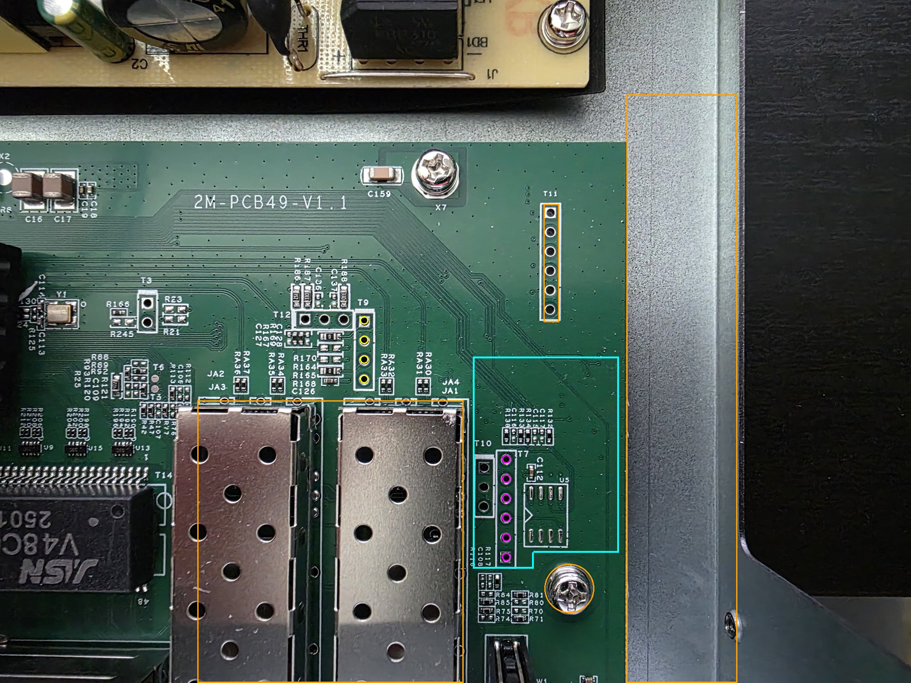

# Mod chip for the MokerLink POE-2G040210GSM

A second board for the PoE switch (PCB `2M-PCB49-V1.1`, RTL8372 with 2 MiB of flash): the same RP2350
circuit as the SWTG024AS-V2.0 board in `../`, cut down to what this switch offers and made as small as
it can be.

- **Size.** The board is 18.9 × 27.5 mm, with a corner cut away for the screw head beside T7. For
  comparison, the first board is 57 × 37 mm.
- **Placement.** It sits on T7 (the slave interface) beside the right SFP cage, on a male header
  soldered on its underside.
- **Wiring.** Four wires run from its pads J3 to T9 (the serial console), about 17 mm away.



**Status:** designed and routed with a clean DRC. Not built yet. **The T7 and T9 signal pins are
guesses.** Check them before ordering (see the end of this page).

| File | What |
|---|---|
| `modchip-poe.kicad_pcb`, `modchip-poe.kicad_pro` | KiCad 10 board. The outline is on Edge.Cuts and J1 is on the bottom side on T7's holes. The switch's parts are drawn on Dwgs.User and notes are on Cmts.User. The aux and grid origin is T7 pin 1 |
| `make_pcb.py`, `build.sh`, `modchip-poe.kicad_dru` | Layout and routing pipeline (as in `../`, with `../finish.py`), and JLCPCB's design rules |
| `modchip-poe.kicad_sch`, `schematic-poe.pdf` | Schematic, and a PDF of it |
| `make_sch.py` | Generates the schematic. It uses `../make_sch.py`'s generator and lists every pin's net |
| `check_sch.py`, `expected-nets.json` | ERC, plus KiCad's netlist compared pin by pin with the intended nets |
| `outline.py`, `overlay.jpg` | The outline, T7/T9/T10 and the obstacles in one place. Running it checks the clearances; `--photo` draws them on the photo |
| `lib/` | Footprints for U5 and L1, imported from LCSC, and L1's 3D model. U5 uses KiCad's Winbond USON-8 model |
| `production/` | JLCPCB files: Gerbers and drill zip, BOM, positions |
| `mechanical/` | STL and STEP of the assembled board, without J1/J3/J5, for a printed fit check |

Rebuild everything from the schematic to the production files with:

```
KAK=~/Desktop/Workspace/KiCad/kicad-agent-kit ./build.sh
python3 outline.py --photo headers.jpg   # RTLPlayground doc/devices/photos/2M-PCB49-V1.1/headers.jpg
```

## Circuit

The circuit is that of `../make_sch.py`, with these changes:

- **No USB.** Power comes from the switch's 3.3 V on T7 pin 4, through the LM66100 ideal diode U2.
  Programming and debug go over SWD (J5).
- **Bench power.** A debug probe can power the board on J5 pin 1; U2 keeps that supply out of the
  switch.
- **Flash.** U5 is a W25Q16JVUXIQ, 2 MiB in USON-8 2×3 mm, fitted with an RP2350A. The RP2354A has the
  same 2 MiB inside its package, but JLC has only a handful in stock. With an RP2354A in U1's place,
  leave U5 and C19 off.
- **Not on this board.** There is no T8-style GPIO header, since this switch has none, and no reset
  driver, since no reset point is known.
- **GPIO use is the same as the first board**, so the firmware's pin map holds:

  | GPIO | Use |
  |---|---|
  | GP0 / GP1 | UART0 |
  | GP11 / GP10 | I²C1 SCL / SDA |
  | GP9 / GP8 | T7 pins 5 / 6 |
  | GP22 | LED |
  | GP26 | Switch-power sense |

- **Series resistors and pull-ups.** Every line to the switch has 100 Ω in series. The I²C lines have
  4.7 kΩ pull-ups to the switch's 3.3 V.

| Pad | Signal |
|---|---|
| J1 (into T7) | 1 SCL, 2 GND, 3 SDA, 4 3.3 V from the switch, 5 GP9, 6 GP8 |
| J3 (wires to T9, pad n to pin n) | 1 the switch's U0TXD, 2 GND, 3 the switch's U0RXD, 4 not connected |
| J5 (SWD, 1.27 mm) | 1 3.3 V, 2 SWCLK, 3 GND, 4 SWDIO, 5 RUN |

`python3 check_sch.py` reports a clean ERC and all 168 pins on their intended nets (33 nets).

## Layout

The board has 4 layers, 1.0 mm thick:

| Layer | Use |
|---|---|
| F.Cu | Parts, signals and a GND pour |
| In1 | GND |
| In2 | +3V3 |
| B.Cu | Signals and a GND pour |

Only J1 is on the bottom side. `make_pcb.py` places these parts by hand:

- **U1** with GP0-GP11 facing J1.
- **The series resistors** in a column between J1 and U1.
- **The core regulator** (L1, CIN, COUT and the VREG_AVDD RC) above U1's VREG pins.
- **U5**, turned so that its SD0, SCLK, SD3 and VCC pins sit straight over U1's QSPI pins.
- **The crystal** in the corner below U1.
- **The SWD pads** along the right edge.

The other parts are auto-placed. Locked hand routes cover:

- VREG_LX and VREG_AVDD;
- the +3V3 trunk to CIN;
- the three straight QSPI lines and T7_P6;
- +1V1: a via at each DVDD pin and VREG_FB, joined on B.Cu by a cross through U1's exposed-pad vias.
  The footprint's B.Cu copper under the pad is removed for that.

Freerouting routes the rest, with analytics and telemetry off on its command line. The result has no
DRC errors or warnings and is fully connected.

## Ordering (`production/`)

- **Board.** 4 layers, 1.0 mm thick, 0.2 mm minimum via drill.
- **Assembly.** PCBA on the top side only: 41 parts, 18 BOM lines, every line with an LCSC number.
- **Parts.** All are in stock as of 2026-11-02. Basic parts throughout, except five Extended ones:

  | Part | LCSC | Stock |
  |---|---|---|
  | RP2350A | C42411118 | 4,697 |
  | W25Q16JVUXIQ | C2843335 | 450 |
  | ABM8 crystal | C20625731 | 8,774 |
  | LM66100 | C2869734 | 11,326 |
  | 3.3 µH inductor, FNR201610S3R3MT | C167673 | 1,380 |

- **The inductor.** The first board's AOTA-B201610S3R3 (C42411119, the part the RP2350 datasheet
  names) is down to 1 in stock. This board uses a shielded 2016 3.3 µH instead, rated 880 mA,
  plenty for the core supply. The first board's BOM needs the same substitute until the AOTA is back.
- **Not assembled.** J1 is a 1×6 2.54 mm male header, hand-soldered from below. J3 and J5 are bare
  pads.
- **Check in JLC's preview.** The rotation of U1, U5 (USON-8), U2, Y1 and L1.

## Before ordering a board

1. **Confirm T7's pinout.** Pin 2 GND and pin 4 3.3 V were measured on the switch. Pins 1/3
   (SCL/SDA) and 5/6 are copied from the 2M-PCB23-V3.1's T7. Check them with continuity, from T7 to the
   RTL8372's slave-interface pins, before ordering. If SCL and SDA are swapped, the RP2350's PIO can
   run I²C on either pin, so the board still works with a firmware change.
2. **Confirm T9's pinout.** Pin 1 TX and pin 3 RX are also a guess. Check with a USB-serial adapter at
   boot; a swap there only means crossing two wires.
3. **Keep T10 bare.** T10, three holes beside T7, sits under the board, so it must stay without pins.
4. **Check the fit.** The positions come from a photo, at 16.93 px/mm and about ±0.5 mm away from T7.
   The outline keeps at least 1.0 mm from the SFP cage, the screw head and the main PCB's edge.
   Print `mechanical/modchip-poe-no-headers.stl` or lay a 1:1 print of the outline on the switch.
5. **Measure the height.** The board sits on J1's plastic spacer, about 2.5 mm above the switch PCB.
   It is 1.0 mm thick and its tallest part reaches 1.1 mm above it. Trim J1's pins flush on top, and
   check the lid's clearance over T7.
6. **Remember the firmware.** The 8051 bridge in RTLPlayground's `feat/modchip` has no
   `POE_2G040210GSM` build yet.
